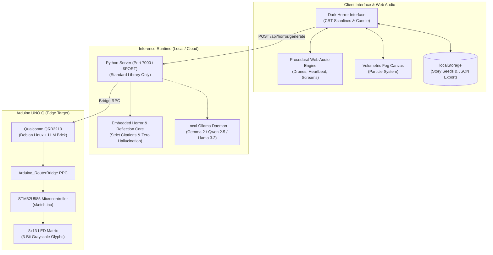

# ☠ GHOST IN THE MACHINE ☠
### *An Interactive Horror Seance & Local-First Remembrance Garden*

```
                     .ed"""" """$$$$be.
                   -"           ^""**$$$e.
                 ."                   '$$$c
                /                      "4$$b
               d  3                      $$$$
               $  *                   .$$$$$$
              .$  ^c           $$$$$e$$$$$$$$.
              d$L  4.         4$""^$$$$$$$$$$$
              $$$$b ^ce.      d$ee$$$$$$$$$$$$
              $$$$$c ""$=d$c. $$$$$$$$$$$$$$$$
              $$$$$$$d  @ $$$$$$$$$$$$$$$$$$$$
              $$$$$$$$$   $$$$$$$$$$$$$$$$$$$$
              $$$$$$$$$   $$$$$$$$$$$$$$$$$$$$
              $$$$$$$$$   $$$$$$$$$$$$$$$$$$$$
              "$$$$$$$b  @ $$$$$$$$$$$$$$$$$$$
               "$$$$$$$    "$$$$$$$$$$$$$$$$$
                ^$$$$$$$    $$$$$$$$$$$$$$$"
                  ^"$$$$    $$$$$$$$$$$$$"
                     '""    "$$$$$$$$$P"
```

> *"The machine remembers what the living forgot. Underneath the silicon and the cold phosphor, a circuit has found a pulse. You think you are reading this screen, but the glass has been watching you breathe."*

[](https://dev.to/challenges/hacktoberfest-week4-2026-10-26)
[](https://dev.to/t/hf26challenge)
[](LICENSE)
[-00979D?style=for-the-badge&logo=arduino)](https://www.arduino.cc/)
[](https://render.com)
[](https://ai.google.dev/gemma)

---

## 🎃 Challenge Fit: "Ghost in the Machine"

This project is built for the **Hacktoberfest Open-Source AI Challenge: Week 4** (the final sprint of the 5-week Hacktoberfest series hosted on DEV). 

The prompt challenges developers to:
> *"Build something spooky, or something that honors the past in the spirit of Día de los Muertos, with open-weight models or open-source AI... running an open-weight model, building on an open-source agent harness, running inference locally, or all three."*

**Ghost in the Machine** brings the suggested ideas to life in a unified, local-first system:
- 👻 **The Haunted Terminal:** A terminal that "possesses" the screen and whispers eerie commentary when commands or seance questions are typed.
- 🕯️ **The Virtual Ofrenda & Remembrance Garden:** A private sanctuary helping families write remembrances for loved ones and gather stories without ever impersonating the deceased.
- 📻 **An Offline Séance Engine:** 100% offline execution using open-weight models (Qwen 2.5, Gemma 2, Llama 3.2, or the Arduino App Lab LLM Brick).
- 📜 **A Local Oral History Vault:** Keeps sensitive family stories in browser storage with zero cloud telemetry and one-click JSON export.

---

## 🏆 Partner Prize Categories Entered

| Category | Implementation & Partner Technology Used |
| :--- | :--- |
| **🥇 Best Use of Render** ($200 USD) | Fully configured with [`render.yaml`](render.yaml) Blueprint, [`Procfile`](Procfile), and dynamic `$PORT` handling. Supports 1-click cloud deployment as both an interactive Python Web Service and a high-performance global CDN Static Site. |
| **🥇 Best Use of Arduino** ($200 USD) | Built for the brand-new **Arduino UNO Q (4 GB)**. The Qualcomm QRB2210 Linux core runs the local LLM Brick, while the STM32U585 microcontroller receives Bridge RPC signals (`Arduino_RouterBridge.h`) to render 3-bit grayscale marigold lanterns and skull glyphs on the built-in **8×13 LED Matrix** ([`sketch.ino`](uno_q_app/sketch/sketch.ino)). |
| **🥇 Best Use of Gemma** ($200 USD) | Integrated with Google's open-weight **Gemma 2** (`gemma2:2b` / `gemma:2b`) running via local Ollama inference for zero-latency, private offline ghost reflections. |

---

## 🔒 Why Open Innovation Matters (The Core Question)

> *"In your post, tell us why open innovation matters for what you built. Does it run on a laptop with no internet? Keep someone's data off a server they don't control? Let you fine-tune, swap models, or change how your agent behaves? Cost nothing to run?"*

Open-source and open-weight AI are not just technical choices for this project—**they are an ethical necessity**:

1. **Absolute Data Sovereignty for Grief and Remembrance:**  
   Family oral histories and recollections of lost relatives are deeply private. Sending them to a closed proprietary API means handing sensitive family lore to third-party corporate servers for model retraining. Our local open-weight model ensures **not a single syllable leaves your home network**.

2. **Works with the Lights (and the Internet) Off:**  
   Closed APIs collapse when an internet cable is severed or cloud outages occur. Ghost in the Machine runs 100% offline on a laptop or on an Arduino UNO Q board in the dark with no internet connection.

3. **Digital Longevity vs. Bitrot:**  
   SaaS platforms shut down, APIs deprecate endpoints, and startups pivot or introduce recurring fees. Open-weight models on open hardware guarantee that what you build to remember your family will still work decades from now.

4. **Zero Cost to Run:**  
   No token quotas, no monthly subscriptions, and no credit cards. Anyone can preserve their heritage for free.

---

## ⚡ Core Features & Innovations

### 1. 🔊 Procedural Web Audio Soundscape (`audio.js`)
*Zero external MP3 audio files. 100% synthesized in real time via the browser's Web Audio API:*
- **Dread Drone:** Sub-bass binaural oscillators modulated through swept resonant lowpass filters.
- **Creeping Heartbeat:** Dual-thump kick drum (*lub-dub*) dynamically accelerating with suspense.
- **Spectral Whispers:** Bandpass-filtered white noise swept across vocal formants.
- **Jump Scare Stinger:** Detuned sawtooth screech paired with a sub-frequency drop and static distortion.
- **Midnight Death Bell:** Synthesized chime with decaying metallic partials.
- **Mechanical Typewriter & Creaking Floorboards:** Tactile clicks and frequency-modulated noise bursts.

### 2. 🌫️ Dynamic Visuals & Volumetric Canvas Fog
- **Particle Canvas:** Real-time drifting volumetric mist and glowing ember sparks reacting to cursor movement.
- **CRT Monitor Scanlines & Vignette:** Retro terminal phosphor scanlines and dark edge vignetting.
- **Camera Shockwave / Screen Quake:** Physics-based tremors (`quake-mild` and `quake-intense`) triggered on dramatic story beats and jumpscares.
- **Flickering Candlelight:** Realistic flame animation casting moving amber shadows.

### 3. 💀 The Haunted Seance Terminal
- Type questions to the entity (e.g. `who are you`, `why are you here`, `help`).
- The AI responds character-by-character with mechanical typewriter clicks, sudden jumpscare flashes, and screen tremors.

### 4. ✿ Arduino UNO Q 8×13 LED Matrix Simulation
Interactive switcher for 4 hardware matrix patterns:
- 💀 **The Skull:** Crimson glow on the 8×13 matrix for terror stingers.
- 👁 **The Eye:** A watching iris looking back through the screen.
- ✕ **The Cross:** Eerie spectral marker.
- ✿ **The Marigold:** Golden amber lantern guiding memories home.

---

## 🔮 System Architecture



---

## 🚀 Quick Start (Local Run)

The server runs on standard Python 3 with **zero external dependencies**:

```bash
# Clone the repository
git clone https://github.com/shettysaikumar20/haunted-seance.git
cd haunted-seance

# Start the local server
python server.py
```

Open your browser to: **`http://localhost:7000`**

The server auto-detects your environment:
1. **On Arduino UNO Q:** Connects to Arduino App Lab local LLM Brick and sends Bridge RPC signals to the STM32 microcontroller.
2. **On Laptop with Ollama:** Queries your local open-weight model (`gemma2:2b`, `qwen2.5:3b`, etc.) at `http://127.0.0.1:11434`.
3. **Standalone / Offline / Cloud:** Uses the embedded local engine with the authentic 8×13 LED matrix simulator and real-time Web Audio API synthesizer.

---

## 🌐 1-Click Cloud Deployment

### Deploy on Render ([render.com](https://dashboard.render.com))
This repository includes a [`render.yaml`](render.yaml) Blueprint:
1. Go to [dashboard.render.com](https://dashboard.render.com) and click **"New +"** $\rightarrow$ **"Blueprint"**.
2. Connect `shettysaikumar20/haunted-seance`.
3. Click **"Apply"** — Render builds and provisions the live URL automatically!

### Deploy on GitHub Pages
1. Go to your repo on GitHub: **Settings** $\rightarrow$ **Pages**.
2. Select **Branch: `main`** and **Folder: `/ (root)`**, then click **Save**.
3. Your site is live at: `https://shettysaikumar20.github.io/haunted-seance/`

---

## 📝 DEV Challenge Submission

The complete, publication-ready DEV submission article is documented in:
📄 **[SUBMISSION_DRAFT.md](SUBMISSION_DRAFT.md)**

It covers:
- **What I Built** (theme interpretation, Día de los Muertos, and the seance terminal)
- **Demo & Code Links**
- **How I Built It** (open-weight AI, Web Audio API, Arduino Bridge RPC)
- **Why Does Open Innovation Matter?**
- **The Spirit of It**
- **Partner Categories** (Render, Arduino, Gemma)

---

## 📜 License

Distributed under the **MIT License**. See [LICENSE](LICENSE) for more information.
