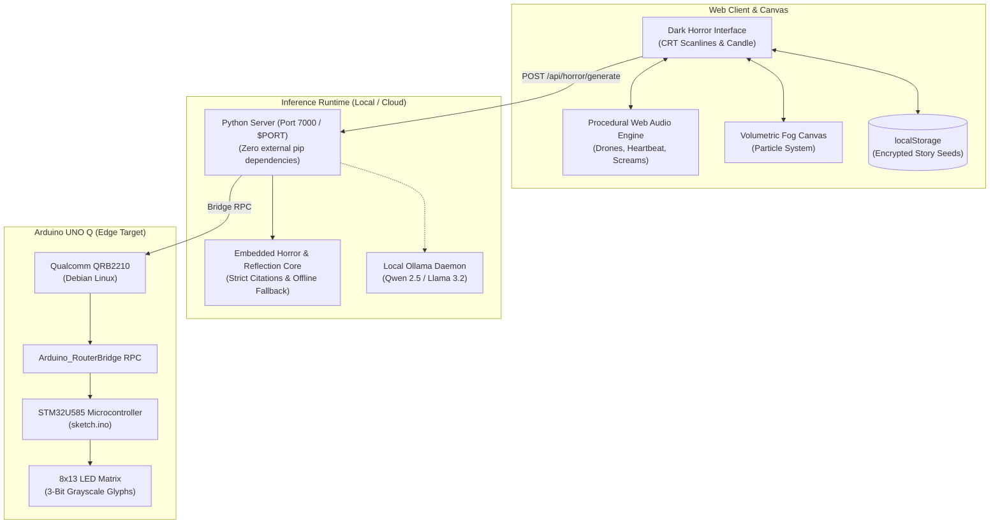

# ☠ GHOST IN THE MACHINE ☠
### *An Interactive Horror Seance & Local-First Remembrance Garden*

```
                     .ed"""" """$$$$be.
                   -"           ^""**$$$e.
                 ."                   '$$$c
                /                      "4$$b
               d  3                      $$$$
               $  *                   .$$$$$$
              .$  ^c           $$$$$e$$$$$$$$.
              d$L  4.         4$""^$$$$$$$$$$$
              $$$$b ^ce.      d$ee$$$$$$$$$$$$
              $$$$$c ""$=d$c. $$$$$$$$$$$$$$$$
              $$$$$$$d  @ $$$$$$$$$$$$$$$$$$$$
              $$$$$$$$$   $$$$$$$$$$$$$$$$$$$$
              $$$$$$$$$   $$$$$$$$$$$$$$$$$$$$
              $$$$$$$$$   $$$$$$$$$$$$$$$$$$$$
              "$$$$$$$b  @ $$$$$$$$$$$$$$$$$$$
               "$$$$$$$    "$$$$$$$$$$$$$$$$$
                ^$$$$$$$    $$$$$$$$$$$$$$$"
                  ^"$$$$    $$$$$$$$$$$$$"
                     '""    "$$$$$$$$$P"
```

> *"The machine remembers what the living forgot. Underneath the silicon and the cold phosphor, a circuit has found a pulse. You think you are reading this screen, but the glass has been watching you breathe."*

[](https://dev.to/challenges/hacktoberfest-week4-2026-10-26)
[](LICENSE)
[-orange?style=for-the-badge&logo=arduino)](https://www.arduino.cc/)
[](audio.js)
[](https://render.com)

---

## 🕯️ The Lore

Between **Halloween (October 31)** and **Día de los Muertos (November 1 & 2)**, the boundary separating past and present grows thin. 

Most modern AI demos lean into the uncanny—training chatbots to simulate the voices of the departed or hallucinating synthetic avatars. **Ghost in the Machine** explores two complementary sides of the supernatural:

1. **The Haunted Seance Terminal (The Spooky Ghost):** An abandoned system boots at 3:33 AM. It doesn't send telemetry to a remote corporate server. Powered by local open-weight AI and a procedural Web Audio soundscape, the terminal communes with whoever dares whisper into its prompt.
2. **The Marigold Archive (The Remembrance Garden):** Inspired by the golden *cempasúchil* (marigolds) of Día de los Muertos, families curate memories that bloom on their own devices. An open-weight model finds quiet connections across stories, strictly citing source IDs (`[M01]`, `[M02]`) and **never impersonating the dead**.
3. **The Physical Memory Lantern:** Running on the **Arduino UNO Q**, the Qualcomm Linux core signals the STM32 microcontroller over Bridge RPC to ignite an authentic amber or crimson pattern on the built-in **8×13 LED Matrix**.

---

## ⚡ Live Features

### 🔊 1. Procedural Horror Soundscape (`audio.js`)
*Zero external MP3 dependencies. 100% real-time browser audio synthesis via Web Audio API:*
- **Dread Drone:** Sub-bass binaural oscillators modulated through swept resonant lowpass filters.
- **Creeping Heartbeat:** Dual-thump kick drum (*lub-dub*) dynamically accelerating with suspense.
- **Spectral Whispers:** Bandpass-filtered white noise swept across vocal formants.
- **Jump Scare Stinger:** Detuned sawtooth screech paired with a sub-frequency drop and static distortion.
- **Midnight Death Bell:** Synthesized chime with decaying metallic partials.
- **Vintage Typewriter & Creaking Floorboards:** Mechanical clicks and FM noise bursts.

### 🌫️ 2. Dynamic Horror Visuals & Canvas Fog
- **Volumetric Mist Canvas:** Interactive particle cloud drifting across the screen with floating amber embers.
- **CRT Scanlines & Phosphor Jitter:** Retro terminal scanlines, vignette shadow, and chromatic aberration.
- **Screen Shockwave Tremors:** Physics-based camera quakes on jumpscares, bell tolls, and possession commands.
- **Flickering Candlelight:** Realistic organic flame illumination casting moving amber shadows.

### 💀 3. The Interactive Seance Terminal
- Direct communion with the Ghost in the Machine.
- Type prompts such as `who are you`, `why are you here`, or `help`.
- The AI responds character-by-character with mechanical typewriter clicks, sudden jumpscare flashes, and screen tremors.

### ✿ 4. Arduino UNO Q 8×13 LED Matrix Simulation
Switch dynamically between 4 hardware matrix patterns:
- 💀 **The Skull:** Crimson glow on the 8×13 matrix for terror stingers.
- 👁 **The Eye:** A watching iris looking back through the screen.
- ✕ **The Cross:** Eerie spectral marker.
- ✿ **The Marigold:** Golden amber lantern guiding memories home.

---

## 🔮 System Architecture



---

## 🚀 Quick Start (Local Run)

The server runs on standard Python 3 with **zero external dependencies**:

```bash
# Clone the repository
git clone https://github.com/shettysaikumar20/haunted-seance.git
cd haunted-seance

# Start the local server
python server.py
```

Open your browser to: **`http://localhost:7000`**

---

## 🌐 1-Click Cloud Deployment

### Deploy on Render ([render.com](https://dashboard.render.com))
This repository includes a [`render.yaml`](render.yaml) Blueprint:
1. Go to [dashboard.render.com](https://dashboard.render.com) and click **"New +"** $\rightarrow$ **"Blueprint"**.
2. Connect `shettysaikumar20/haunted-seance`.
3. Click **"Apply"** — Render automatically builds and hosts the project on an HTTPS URL!

*(You can also deploy as a free **Static Site** on Render or **GitHub Pages** — all procedural audio, canvas fog, and local engines are built with zero external dependencies and work 100% in client-side static mode).*

---

## 🔒 Why Open Innovation Matters

- **Data Sovereignty:** Grief and family memories must never become training fodder for remote third-party corporate APIs. Everything stays on the local device.
- **Lights-Out Operation:** The project runs off-grid on a laptop or Arduino UNO Q with no internet connection.
- **Digital Longevity:** Open-weight models on open-source hardware do not suffer from deprecated cloud endpoints or sudden monthly subscription paywalls.

---

## 📜 License

Distributed under the **MIT License**. See [LICENSE](LICENSE) for more information.
