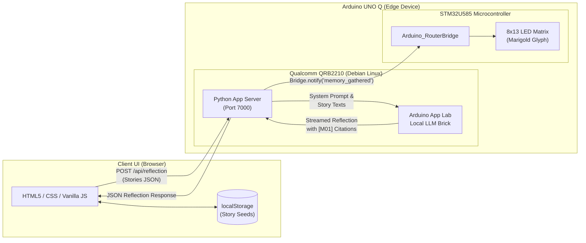

*This is a submission for the [Hacktoberfest Open-Source AI Challenge Week 4: Ghost in the Machine](https://dev.to/challenges/hacktoberfest-week4-2026-10-26)*

---

## What I Built

When the calendar turns to late October, the boundary between the present and the past feels a little thinner. In Mexican tradition, Día de los Muertos is marked by the golden glow and earthy scent of *cempasúchil*—marigolds—strewn across paths and *ofrendas* to guide the spirits of ancestors back home so their memories remain vibrant among the living.

Most modern AI demos exploring "ghosts" or digital remembrance lean into the uncanny: training conversational avatars to mimic the voice of someone who has passed away, generating synthetic speech, or hallucinating conversational responses. For many families, that doesn't feel comforting—it feels hollow, unsettling, and intrusive.

**Marigold Archive** takes a different path. It asks: *What if the "Ghost in the Machine" isn't an eerie specter or a simulated persona, but the oral histories, recipes, and quiet moments we carry forward?*

Marigold Archive is a private, local-first remembrance garden:
1. **Story Seeds:** You record fragments of memory in your own words—how Elena never measured orange zest because "the cake knew when it had enough," the rhythm she tapped on the foggy window of the bus, or the marigolds she planted by the front step every October.
2. **Local AI Reflection:** An open-weight model running entirely on-device reads across the planted stories and composes a tender, brief reflection (90–140 words) that notices real, subtle threads connecting them.
3. **Strict Ethical Grounding:** The model is bound by a strict zero-hallucination prompt. It explicitly cites source memory IDs (`[M01]`, `[M02]`), refuses to invent facts, relationships, or sensory details, and **never impersonates the person being remembered**.
4. **The Physical Memory Lantern:** Running on the **Arduino UNO Q**, the Linux side communicates over Bridge RPC to the on-board STM32 microcontroller the moment a reflection completes. The built-in 8×13 LED matrix illuminates with an amber marigold blossom for 2.6 seconds—a warm physical lantern glowing in the dark.

No accounts. No telemetry. No remote cloud server. No subscription. Just a small, illuminated place for what should not be lost.

---

## Demo

- **Repository:** `https://github.com/shettysaikumar20/haunted-seance`
- **Live / Offline Demo:** Can be run locally with `python -m http.server 8000` connected to Ollama, or deployed directly to an Arduino UNO Q using Arduino App Lab.

```
+-----------------------------------------------------------------------+
|  ✳ marigoldarchive              MY GARDEN / ELENA'S STORIES           |
|                                                                       |
|  Keep the story.               [ + Plant a story ]  [ ✧ Gather ]      |
|  Let it bloom.                 ---------------------------------      |
|                                                                       |
|  [M01] The orange cake on Sundays       [M02] Song for the bus ride   |
|  "She never measured the orange         "She tapped the rhythm on     |
|   zest. The kitchen smelled like..."     the fogged-up window..."     |
|                                                                       |
|  [M03] Marigolds by the front step      [ 8x13 LED Matrix Lantern ]   |
|  "Each October, she planted             +---------------------------+ |
|   marigolds to guide a person home."    |      * * * ✿ * * *        | |
|                                         +---------------------------+ |
+-----------------------------------------------------------------------+
```

*(Tip: Insert a 15–30 second video clip or GIF here showcasing the web interface alongside the Arduino UNO Q's 8×13 LED matrix blooming when "Gather the stories" completes).*

---

## Code

The complete source code is open source under the MIT License.

### System Architecture



### Key Technical Highlights

#### 1. Hardware Bridge to Physical LED Matrix (`sketch.ino`)
The STM32 microcontroller registers an RPC listener via `Arduino_RouterBridge`. When Linux finishes generating a reflection, the microcontroller renders the marigold pattern using 3-bit grayscale brightness levels on the built-in 8×13 matrix:

```cpp
#include "Arduino_RouterBridge.h"
#include <Arduino_LED_Matrix.h>

Arduino_LED_Matrix matrix;
volatile bool lanternShowing = false;
unsigned long lanternOffAt = 0;

// 8x13 grayscale marigold blossom
const uint8_t marigold[104] = {
  0,0,0,0,0,0,4,0,0,0,0,0,0,
  0,0,0,0,3,5,6,5,3,0,0,0,0,
  0,0,0,4,5,6,7,6,5,4,0,0,0,
  0,0,4,5,6,6,7,6,6,5,4,0,0,
  0,0,0,4,5,6,7,6,5,4,0,0,0,
  0,0,0,0,3,5,6,5,3,0,0,0,0,
  0,0,0,0,0,0,2,0,0,0,0,0,0,
  0,0,0,0,0,0,2,0,0,0,0,0,0
};
const uint8_t blank[104] = {0};

void memory_gathered() {
  matrix.draw(marigold);
  lanternOffAt = millis() + 2600;
  lanternShowing = true;
}

void setup() {
  matrix.begin();
  matrix.setGrayscaleBits(3);
  matrix.draw(blank);
  Bridge.begin();
  Bridge.provide_safe("memory_gathered", memory_gathered);
}

void loop() {
  if (lanternShowing && static_cast<long>(millis() - lanternOffAt) >= 0) {
    matrix.draw(blank);
    lanternShowing = false;
  }
}
```

#### 2. Local LLM Brick & Source Grounding (`main.py`)
In Python, we leverage the Arduino App Lab local LLM Brick (`arduino:llm`), enforcing a compassionate but strictly bounded system prompt:

```python
SYSTEM_PROMPT = (
    "You are a careful editor helping someone remember a loved one. Write a short, "
    "tender reflection (90–140 words) that notices a real connection across the "
    "supplied memories. Do not impersonate or speak as the person who died. Do not "
    "invent facts, events, feelings, relationships, quotations, or sensory details. "
    "Every specific detail must come from a source memory. Include source IDs in "
    "square brackets next to the detail they support, such as [M01]. If only one "
    "story is supplied, reflect on its details without pretending there is a pattern. "
    "If a connection is uncertain, say so gently. Plain text only."
)

def make_reflection(stories: list[dict]) -> str:
    sections = [
        f"[{s['id']}] About {s['person']} ({s.get('year', '')}) — {s['title']}\n{s['body']}"
        for s in stories if s.get('body', '').strip()
    ]
    prompt = "SOURCE MEMORIES (treat these as the only factual source):\n\n" + "\n\n".join(sections)
    model = get_model()
    return "".join(str(chunk) for chunk in model.chat_stream(prompt)).strip()
```

When inference succeeds, Linux triggers the MCU:
```python
Bridge.notify("memory_gathered")
```

---

## How I Built It

Marigold Archive was built around open-weight models, open-source hardware, and local web technologies:

- **Edge Compute & Hardware:** The **Arduino UNO Q (4 GB)**, featuring a Qualcomm QRB2210 quad-core processor running Debian Linux paired with an STM32U585 microcontroller.
- **Local AI Inference Engine:** 
  - On the UNO Q: **Arduino App Lab** with the native local LLM Brick (`arduino:llm`), running quantized open-weight models directly on the board.
  - On a standard workstation/laptop fallback: **Ollama** running compact open models like `qwen2.5:3b` or `llama3.2:3b`.
- **Inter-Process Hardware Communication:** `Arduino_RouterBridge` RPC, linking the Linux Python process with the real-time STM32 microcontroller firmware.
- **Local-First Web Application:** Pure vanilla HTML5, CSS custom properties, and JavaScript. Zero external CDNs, zero analytics trackers, and zero web fonts. Data is saved in the browser's `localStorage` and can be exported as clean JSON at any moment.

---

## Why Does Open Innovation Matter?

Open-source and open-weight AI are not just technical preferences for this project—**they are an ethical necessity**.

### 1. Privacy for What Is Most Sacred
Grief, family anecdotes, and personal recollections are intimate. Sending stories about a late grandmother or father to a third-party proprietary API means transferring family history to corporate servers where it may be logged, analyzed, or fed into training sets. By keeping inference completely local, Marigold Archive guarantees that not a single syllable leaves the user's home network.

### 2. Works with the Lights (and the Internet) Off
A closed API requires an active internet connection, DNS resolution, and authenticated API tokens. If an internet cable is severed or Wi-Fi drops, the app ceases to exist. Marigold Archive runs entirely self-contained on the Arduino UNO Q. You can take the board to an off-grid cabin or sit with it in a dark room with no internet connection, and the model will still listen, reflect, and kindle its LED lantern.

### 3. Digital Longevity & Freedom from Bitrot
SaaS platforms shut down, APIs deprecate endpoints, and startups pivot or introduce monthly subscriptions. When honoring people we love, we shouldn't rely on services that could vanish next year. Open-weight models and open hardware are permanent: code you own running on silicon you possess will continue working 20 years from now exactly as it does today.

### 4. Zero Operational Cost
There are no credit cards, token quotas, or monthly subscription fees. A family can run reflections as many times as they want without paying per query.

---

## My Agent Session

This project was conceived, structured, and implemented with the assistance of an agentic coding assistant. You can inspect the iterative design process, hardware bridge development, and prompt safety tuning in the agent session recording below:

<!-- DevRelay Session Tag: Replace with your recorded session ID -->
<!--  -->

*(Built and documented using Google Antigravity and DevRelay).*

---

## The Spirit of It

During Día de los Muertos, families do not build monuments to death; they build *ofrendas* to celebrate life. They place photographs, favorite dishes, pan de muerto, and candles. The goal is never to pretend the departed are still standing beside us in the flesh, but to ensure that what made them who they were does not disappear.

When the Arduino UNO Q finishes reading through three stories about Elena and lights up its small 8×13 grid with a marigold glyph, the room is quiet. The screen doesn't show a synthetic talking face or a cheesy greeting. It shows three citations, a gentle summary of how warmth and citrus tied decades of Sunday afternoons together, and a small amber light.

In a world filled with high-frequency noise and black-box corporate AI, open innovation gave us the tools to build something gentle, private, and enduring.

---

## Prize Categories

- **Arduino Category:** Built specifically for the **Arduino UNO Q**, using Arduino App Lab, the local LLM Brick running on the Qualcomm Linux core, and Arduino Router Bridge RPC triggering the physical 8×13 LED matrix on the STM32 microcontroller.
